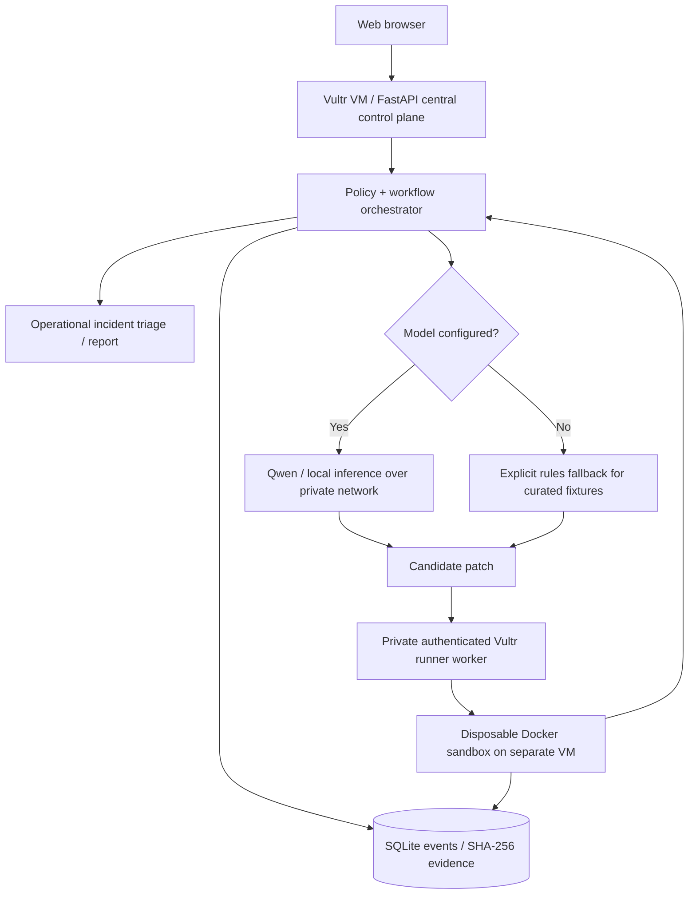

# InnerOS Verified Operations

**Vultr: Agent Rush Hackathon 2026 | Challenge 2: Powering the Future of Work**

> **Status (2026-11-08 · Production Deployed):** Release v0.6.0 fully deployed and verified in production on Vultr Cloud Compute (`45.77.164.161` Miami) with Let's Encrypt TLS at **https://vultr.innerchispa.us/judge** (and **https://45.77.164.161.sslip.io/judge**). Directly integrated with InnerOS Edge Host on AMD 1.5 hardware over a reverse encrypted socket (`127.0.0.1:8795`). Probes real campus hardware, executes local autonomous SRE inference with Qwen 30B ($0.00 spend), records persistent MongoDB tickets (`ops_tickets`), dispatches internal alerts via InnerOS Agent Messaging, enforces human technical ACKs (zero auto-ACK), and upholds the Zero-Fabrication invariant on physical recheck. 100% green test suite (87 unit/contract tests passing).

A mission-critical enterprise operations console that turns infrastructure faults into verifiable workflows and **cryptographically tamper-evident evidence** (SHA-256) rather than conversational promises.

---

## 1. Live Deployment & Architecture

- **Primary Production URL:** [https://vultr.innerchispa.us/judge](https://vultr.innerchispa.us/judge)
- **Alternative Subdomain:** [https://agentrush.innerchispa.us/judge](https://agentrush.innerchispa.us/judge)
- **Direct Fallback URL:** [https://45.77.164.161.sslip.io/judge](https://45.77.164.161.sslip.io/judge)
- **Official Submission:** [LabLab Vultr Agent Rush 2026](https://lablab.build/submissions/cvs2mpnjnhx0kbbqgm3lmo4o)
- **Vultr VM:** `45.77.164.161` (Miami `mia`, plan `vc2-1c-2gb`, Ubuntu 24.04 LTS)
- **Web Runtime:** FastAPI + Uvicorn + Caddy (Automatic HTTPS reverse proxy with Cloudflare DNS integration)
- **Edge Node:** AMD 1.5 Hardware (`inneros-5`) via encrypted reverse tunnel (`127.0.0.1:8795`)
- **Telemetry Integrations:**
  - **Enterprise Campus Core & Access Fabric:** 14 managed infrastructure targets probed in real time by Network Guardian telemetry (core switches, distribution units, wireless access points, IP PBX, and gateway connectivity).
  - **Edge Automation & Device Fabric:** 92 IoT and edge infrastructure entities monitored via Device Fabric telemetry and automation controllers.
- **Inference Engine:** `QuantTrio/Qwen3-Coder-30B-A3B-Instruct-AWQ` via local vLLM on AMD 1.5 ($0.00 spend, zero third-party API dependencies).
- **Persistent Storage:** Local SQLite ledger for execution traces + InnerOS MongoDB (`ops_tickets`) for operational incident tickets.

---

## 2. Mode Separation & Security

The platform enforces a strict separation between two operating modes:

### A. Public Demo Mode (`DEMO PÚBLICA`)
- Available to anonymous evaluators and public hackathon judges.
- Exercises verified synthetic demonstration workflows (incident triage, containment lab with Docker isolation probes, and SQLite hash-linked execution ledger).
- All public outputs are completely sanitized: **zero exposure** of internal IP addresses, hardware serials, Tailscale node names, or tenant topologies.
- Code execution fails closed if Docker sandbox is unavailable.

### B. Authenticated Real Operations Mode (`OPERACIONES REALES · ACCESO PRIVADO`)
- Unlocked exclusively via `Authorization: Bearer <operator_token>`.
- Token entry is supported via the session modal or sidebar; tokens are held strictly in memory/sessionStorage and are **never leaked in URL query parameters (`?token=`), logs, or GitHub**.
- Any compromised legacy tokens (including `inneros-ops-token-bellini-2026` and `sec_ops_vultr_58085a2638f64246547b956c617e6492`) are permanently blacklisted in `REVOKED_TOKENS` and rejected with `HTTP 401 Unauthorized`.
- Connects to genuine hardware telemetry, runs Qwen 30B autonomous SRE reasoning, creates persistent tickets, dispatches internal alerts, and registers human-confirmed ACKs.

---

## 3. End-to-End Operational Pipeline

| Step | Operation | Backend Endpoint | Behavior |
|---|---|---|---|
| **01** | **Live Hardware Sweep** | `POST /api/live/sweep/bellini` | Probes 14 managed campus targets; calculates ICMP loss, TCP open ports, and SHA-256 evidence. |
| **02** | **Autonomous SRE Diagnosis** | `POST /api/live/diagnose` | Qwen 30B local inference on AMD 1.5 ($0.00 spend). Root-cause analysis & strict READ-ONLY containment rules. |
| **03** | **Persist Ticket in MongoDB** | `POST /api/live/ticket` | Creates immutable incident ticket (`TKT-...`, P1 CRITICAL) in InnerOS MongoDB `ops_tickets`. |
| **04A** | **Dispatch Internal Notification** | `POST /api/live/ticket/{id}/notify` | Dispatches internal alert to authorized on-call operations engineer via canonical agent messaging (`DELIVERED`). |
| **04B** | **Register Human Operator ACK** | `POST /api/live/ticket/{id}/ack` | Records explicit human acknowledgment with operator name and technical note (zero fake auto-ACK). |
| **05** | **Physical Hardware Recheck** | `POST /api/live/ticket/{id}/recheck` | Re-probes hardware. Confirms persistent physical failure (`ANOMALY_PERSISTENT`); refuses fake auto-closure. |

---

## 4. Verification & Testing

### Automated Test Suite
Run the full test suite locally or on the VM:
```bash
pytest -v
```
- **85 unit and contract tests passing**, 2 Docker live tests skipped when Docker daemon is not bound.
- Negative security tests verify that unauthenticated requests, revoked tokens, and query parameter leaks are strictly rejected with 401.

### Real Browser QA (Playwright)
```bash
python scripts/judge_browser_qa.py --screenshots .judge-qa
```
- Exercises the guided judge walkthrough on Desktop (1440x900) and Mobile (390x844).
- Verifies document width is strictly `<= 390px` with zero horizontal overflow and zero JavaScript console errors.

### Live Security & Operations Verification
```bash
INNEROS_OPS_TOKEN="<operator_token>" python scripts/verify_live_security_and_ops.py
```
- Executes all 12 live end-to-end security and hardware gates against the live production server.

---

## 5. Deployment and Rollback

### Production Deployment
```bash
# On Vultr VM (45.77.164.161)
cd /opt/inneros-vultr-agent-rush
git fetch origin main
git reset --hard origin/main
systemctl restart inneros-verified-ops.service
```

### Rollback Procedure
```bash
# Rollback to any prior validated commit
git reset --hard <commit_hash>
systemctl restart inneros-verified-ops.service
```

---

## 6. What Works Today

| Module | Behavior | Status |
|---|---|---|
| Web Mission Control | Mobile-friendly UI for real workflow requests, results, and ledger | **VERIFIED (LIVE)** |
| Judge Console (`/judge`) | 5-step operational pipeline + live hardware telemetry | **VERIFIED (LIVE)** |
| Campus Network Guardian | 14 enterprise infrastructure targets ICMP/TCP probe via Edge Host | **VERIFIED (REAL)** |
| Edge Device Fabric | 92 edge entities telemetry and health status | **VERIFIED (REAL)** |
| Qwen 30B Local SRE | Local vLLM on AMD 1.5 ($0.00 spend, zero API cost) | **VERIFIED (REAL)** |
| Operational Ticketing | Persistent MongoDB collection (`ops_tickets`) with SHA-256 | **VERIFIED (REAL)** |
| Agent Notification | Internal dispatch to authorized on-call operations engineer | **VERIFIED (REAL)** |
| Human Operator ACK | Explicit human acknowledgment with technical note | **VERIFIED (REAL)** |
| Zero-Fabrication Invariant | Physical recheck detects persistent anomaly; ticket stays open | **VERIFIED (REAL)** |
| Containment Lab | Curated Docker isolation probes (fails closed without daemon) | **VERIFIED (FAIL-CLOSED)** |
| Security Hardening | Bearer token auth, query-string leak elimination, token revocation | **VERIFIED (BLINDADO)** |
| Vultr Cloud Compute | Miami instance with Caddy TLS reverse proxy & Cloudflare DNS | **VERIFIED (LIVE)** |

**Rules fallback** is always identified as rules, not AI. If no inference model is configured, two built-in demonstration cases use explicit deterministic patch rules. Custom repairs require a configured model and operator authorization.

## Run locally

Requires Python 3.12+.

```bash
python -m venv .venv
. .venv/bin/activate
pip install -r requirements-dev.txt
PUBLIC_DEMO=1 DB_PATH=./data/inneros_agent_rush.sqlite uvicorn inneros_agent_rush.main:app --host 127.0.0.1 --port 8000
```

Open `http://127.0.0.1:8000` for the workspace or `http://127.0.0.1:8000/judge` for the guided judge entrance. **Neither local address qualifies as the hackathon public demo.** The customer support workflow runs even without Docker or an LLM. Code execution **fails closed** until Docker is provisioned.

```bash
pytest -q
```

### Enable isolated code checks (trusted, dedicated development VM only)

1. Install Docker Engine and make the `docker` CLI available to the service user on a **disposable VM with no host secrets**. Docker access grants root-equivalent control of that VM; do not use a shared production host.
2. Prepare a known fixed image:

```bash
docker pull python:3.12-alpine
```

3. Start the API via `uvicorn` directly on that VM. The code runner launches short-lived **separate** containers, with `--network none`, `--read-only`, unprivileged UID, dropped capabilities, no-new-privileges, CPU/RAM/PID limits and a hard client deadline.
4. Prefer running the authenticated worker API on a separate Vultr VM and configuring `SANDBOX_RUNNER_URL` and `RUNNER_TOKEN` in the web backend environment. Never put the runner token in the client-side HTML. See [`docs/DEPLOY_VULTR.md`](docs/DEPLOY_VULTR.md).
5. Use the built-in scenarios through the UI. Try `runaway_loop`: it should return `contained`, not kill the app.

**Warning:** Docker isolation is a useful boundary, not a guarantee against kernel/container-runtime vulnerabilities. The code includes an authenticated remote Docker worker (`inneros_agent_rush.worker_service`), which should run on a separate private, disposable Vultr VM. This separates the public backend from Docker host permissions. For production, strengthen the worker further with gVisor, independent resource monitoring, egress controls, attestations and container lifecycle verification. Do not mount Docker's socket into the public-facing app container.

### Optional local-first LLM

Configure a **server-side** OpenAI-compatible inference endpoint (e.g. Qwen3-Coder through local vLLM or Ollama, connected to the Vultr VM over a private tunnel). These variables never enter the execution containers:

```bash
export LLM_BASE_URL='http://127.0.0.1:11434/v1'
export LLM_MODEL='qwen3-coder:latest'
export LLM_API_KEY=''
```

Use actual model name/URL from your infrastructure, not the example blindly. **Never expose a local unauthenticated model port to the public Internet.** In this challenge Vultr Serverless Inference is optional; Challenge 1 would require it instead.

### Operator access

For real private data, set `PUBLIC_DEMO=0` and a strong `AUTH_TOKEN` in the server environment; send `Authorization: Bearer ...` with API calls. The web UI now has a session-only token field (not stored in localStorage). The public demo mode permits curated repair scenarios, triage and demo-ticket transitions, but **never arbitrary uploaded code** without a matching operator token. Only tickets and runs created without operator credentials are visible to anonymous visitors. Curated demo endpoints are rate-limited. Because public demo stores submitted triage content and lists runs, never submit private customer details in that mode.

A production identity/SSO flow and tenant isolation are still pending. The existing token field is suitable for isolated hackathon demonstrations, not a complete enterprise login system.

## Judge-first release workflow

The judge-facing page is now an explicit route: `GET /judge`, powered by the same FastAPI service and real APIs as the regular workspace. It guides a visitor through (1) fictional incident intake and linked service ticket creation, (2) independent SHA-256 artifact and event-chain verification and (3) acknowledgement and closure of a **synthetic** ticket. It clearly states that no physical device was repaired. The frontend does not show the backend as online before the live health check responds.

- `docs/JUDGE_ACCEPTANCE.md` defines mandatory functionality, public-link criteria, and the reusable InnerChispa hackathon release gate.
- `python scripts/judge_browser_qa.py --screenshots .judge-qa` is a real Chromium interaction test, covering judge buttons, standard ticket UI and mobile layout. Install Playwright and Chromium before running; it is also integrated into GitHub Actions. The browser was blocked by administrator policy in the current local environment and **has not passed here**.
- `scripts/smoke_deployment.py` now verifies the public `/judge` entrance, report hash, ticket and lifecycle, not just `/healthz`.
- Until GitHub/Vultr deployment is confirmed, all links shown in project documentation remain local or explicit placeholders.

## API

| Endpoint | Purpose |
|---|---|
| `GET /healthz` | Readiness (Docker and model configuration disclosed) |
| `GET /judge` | Guided judge panel using the same real backend |
| `GET /api/cases` | Built-in repair scenarios |
| `POST /api/triage` | Classify + plan + produce actual report |
| `POST /api/repair` | Execute isolated verification; fails closed without Docker |
| `GET /api/runs` | Recent execution ledger |
| `GET /api/runs/{id}` | Evidence events and chain validation |
| `GET /api/runs/{id}/verify` | Independent report SHA-256 and event-chain consistency verification |
| `GET /api/runs/{id}/artifact` | Report or candidate code as plain text |
| `GET /api/tickets` | List tickets visible to public demo or authenticated operator |
| `GET /api/tickets/{id}` | Ticket status, evidence chain, and integrity validation |
| `POST /api/tickets/{id}/action` | Acknowledge / resolve / reopen with mandatory note and atomic persisted transition |

Example request (after starting in public demo mode):

```bash
curl -s -X POST http://127.0.0.1:8000/api/triage \
  -H 'Content-Type: application/json' \
  -d '{"title":"Fiber uplink offline", "description":"Switch port lost optical signal", "customer":"Demo customer"}'
```

## Architecture



**Vultr's intended role:** hosting the public web app, central backend, database and workflow coordination. Code execution on a separate dedicated VM/runner is the recommended hardening step. The implemented worker is authenticated and can run on a second Vultr VM. The repo contains a Vultr deployment playbook at [`docs/DEPLOY_VULTR.md`](docs/DEPLOY_VULTR.md). The current local MVP is *not* represented as already running in Vultr.

## Demonstration narrative (2–3 minutes)

1. Introduce an actual small-business service problem: an important fiber uplink is down.
2. Submit the incident. Show the category, priority and response plan generated by executing the workflow.
3. Show a service ticket, acknowledge it, record a resolution note, and prove the status history hash chain.
4. Show event trace, evidence hash, persistent ledger, and retrieved artifact.
5. On a dedicated sandbox VM, run an off-by-one repair. Show fail -> patch -> pass and the corresponding runner evidence.
6. Run an infinite loop. Show container deadline and safe termination, without impact on the web interface.
7. Explain how the Vultr backend coordinates operations while local sovereign models generate constrained candidate changes.

**Note:** Video should record actual execution, not synthetic traces. Capture the Vultr public URL only after deployment is complete.


## Publishing and deployment readiness

A completely separate local Git repository is included in the delivery bundle. This project
**has not yet been published to GitHub or deployed to Vultr**. Do not use a made-up public
URL for judging.

- `python scripts/publish_github.py`: read-only publication plan.
- On Windows, with an authenticated GitHub CLI session (`gh auth status`), the same script can publish with `--execute`, without pasting a token into the chat.
- `python scripts/publish_github.py --execute` with an authenticated local GitHub CLI (`gh auth login`) or a private `GITHUB_TOKEN`: creates an empty public repository under the verified `Rafa-Innerchispa` account and pushes `main`. It requires a token in the private environment and never embeds tokens in the Git remote.
- `python scripts/smoke_deployment.py --url https://YOUR-VULTR-DEMO`: creates one fictional incident on the actual deployment and checks API, evidence-chain and ticket persistence.
- `.github/workflows/test.yml` contains separate unit and **real Docker isolation integration** jobs. The latter cannot be reported as passed until GitHub Actions has actually run it.
- `docs/WORK_HANDOFF.md` contains the exact remaining steps for an agent with authorized GitHub and Vultr access.

## Judging / provenance

- Category: **Powering the Future of Work**. This category permits rule-based and agentic multi-step workflows, and does not require Vultr Serverless Inference.
- Technology: Python FastAPI, SQLite, vanilla JS/CSS, Docker isolation adapter, optional local OpenAI-compatible models.
- Originality: a traceable enterprise operations workflow connecting incident handling to provable outputs instead of a standalone chat agent.
- Business value: operational SLA prioritization, reproducible service plans and auditor-friendly evidence.
- Provenance: Clean hackathon implementation, influenced by the InnerOS operational architecture. Any prior components reused from elsewhere must be declared before submission; this repository contains no copied production credentials or proprietary customer records.
- Required artifacts still outstanding: Vultr VM deploy, public demo URL, authentic recorded video, LabLab submission and cover/presentation.

Official event: [Vultr Agent Rush at lablab.ai](https://lablab.ai/ai-hackathons/vultr-hackathon).

MIT License. Copyright (c) 2026 InnerChispa LLC.

## Containment Lab / second technical front (v0.6.0)

The same web app includes an optional **Containment Lab** tab and backend API:
`GET /api/containment/scenarios` and `POST /api/containment/verify` with
`{ "scenario_id": "network_egress|read_only_root|runaway_timeout" }`.
Only predefined code is accepted in the public demo. The worker verifies network
isolation, a read-only root filesystem and forced termination, then checks Docker
for container removal. It stores a SHA-256 chain plus a content-verified report.
No Docker worker means `blocked`, not a fake PASS. This does **not** by itself
qualify for Blast Radius Zero; Vultr-specific sandbox and Serverless Inference
requirements must be demonstrated on actual Vultr infrastructure.

### Launch locally on AMD/Intel/WSL (no Vultr account required)

```bash
bash scripts/run_local.sh
# Open http://127.0.0.1:8000/judge in a local browser.
```

This binds only loopback and uses an isolated local SQLite file. Installing it on
the physical AMD machine requires a real authorized connection; the downloadable
package is not evidence it has been installed on that server.

### Deploy on a small Vultr VM after you have access

```bash
# On the authorized VM after Docker + Compose are installed, from this repo:
bash scripts/deploy_vultr.sh --domain demo.example.org
# Dry run does not deploy. Then, with a real DNS name that points to the VM:
bash scripts/deploy_vultr.sh --domain demo.example.org --apply --verify
```

This starts Caddy for public HTTPS and the FastAPI app inside Docker, with
Caddy persisting certificates and the API port bound to `127.0.0.1`. Use a real
DNS record, not the example hostname. The demo API has a simple rate limit and
must never receive private customer data. Docker execution on the **public**
backend remains unavailable unless an isolated worker VM is explicitly
configured. See `docs/DEPLOY_VULTR.md` and `docs/JUDGE_ACCEPTANCE.md`.
