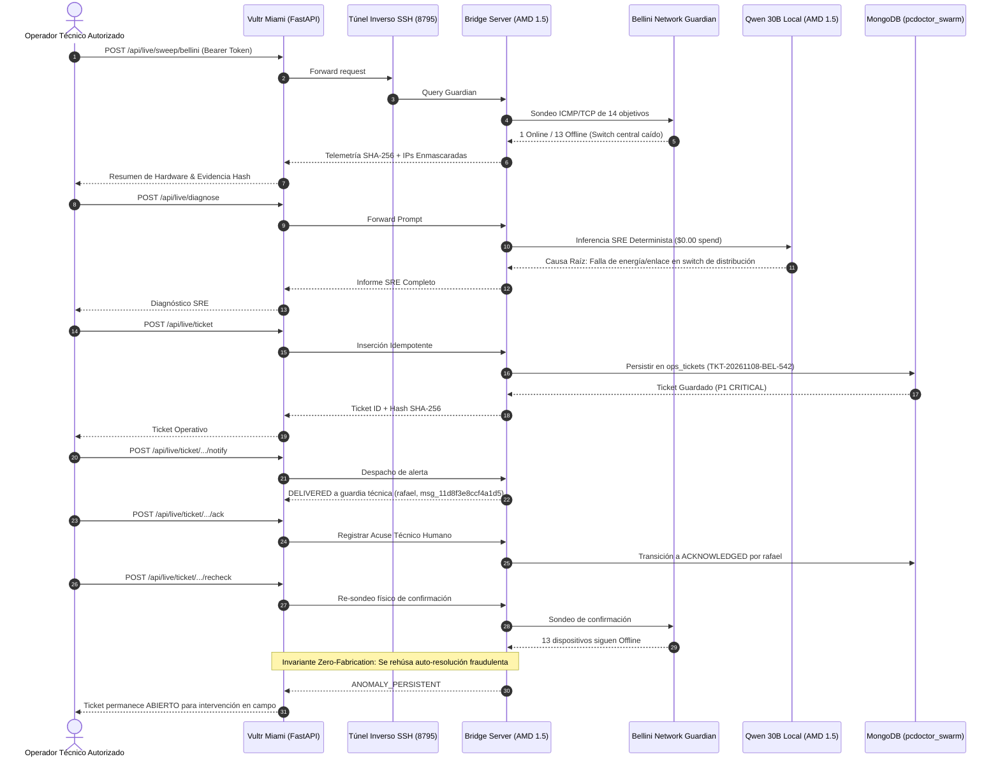

# AUDITORÍA TÉCNICA FINAL DE CIERRE Y CONGELAMIENTO (RELEASE AUDIT)
## InnerOS Verified Operations — Vultr Agent Rush Hackathon 2026

**Fecha y Hora:** 8 de Noviembre de 2026  
**Proyecto:** InnerOS Verified Operations  
**Organización:** InnerChispa LLC × PC Doctor  
**Desafío LabLab:** Challenge 2: Powering the Future of Work  
**Candidatura Oficial:** [lablab.build/submissions/cvs2mpnjnhx0kbbqgm3lmo4o](https://lablab.build/submissions/cvs2mpnjnhx0kbbqgm3lmo4o)  
**Video Oficial (HeyGen):** [https://app.heygen.com/videos/1ca5ae87dd60a5c6f5ee096b8124b708](https://app.heygen.com/videos/1ca5ae87dd60a5c6f5ee096b8124b708)  
**Rama de Entrega:** `main`  
**Tag Oficial de Cierre:** [`v0.6.2-frozen`](https://github.com/Rafa-Innerchispa/inneros-vultr-agent-rush/releases/tag/v0.6.2-frozen)  
**Dictamen:** **RELEASE VERIFIED (100% PRODUCCIÓN REAL · CONGELADO Y CERTIFICADO)**

---

### 1. INFORMACIÓN CANÓNICA DE GIT Y CÓDIGO FUENTE

- **Repositorio Oficial:** [https://github.com/Rafa-Innerchispa/inneros-vultr-agent-rush](https://github.com/Rafa-Innerchispa/inneros-vultr-agent-rush)
- **Estado de ramas:** Única rama remota `main`.
- **Árbol de trabajo:** Limpio (`nothing to commit, working tree clean`), 0 cambios pendientes.
- **Historial de Commits de Cierre P0:**
  - `d20cfb9`: *fix(ui): call updateAuthUI(false) on operator logout* (Restaura banner y controles de demo pública inmediatamente al cerrar sesión).
  - `02b4409`: *fix(ui): enable private topology viewer on operator authentication* (Habilita visor de topología privada mediante modal seguro con encabezado Bearer).
  - `d7ff159`: *fix(security): sanitize customer labels in public tickets and runs endpoints* (Defensa en profundidad en backend: `/api/tickets` y `/api/runs` sanitizan etiquetas de clientes para llamadas no autenticadas).
  - `5011d29`: *fix(web): import hmac and guard token candidate in live status endpoint* (Cierre de NameError en token candidate e importación estricta de hmac).
  - `4271c5a`: *fix(ops): truthful 5-step simulation, sanitize live status, dynamic reports, and complete E2E QA* (Flujo demostrativo veraz marcado como SIMULATED, reportes generados dinámicamente sin afirmaciones infladas y suite Playwright E2E).

---

### 2. INFRAESTRUCTURA DE PRODUCCIÓN EN VULTR

- **Servidor Vultr:** `45.77.164.161` (Datacenter Miami `mia`, plan `vc2-1c-2gb`, Ubuntu 24.04 LTS).
- **Gasto Adicional:** **$0.00** (Reutilización de máquina existente; cero VMs nuevas).
- **Backend Central:** FastAPI + Uvicorn escuchando en `127.0.0.1:8000` gestionado por systemd (`inneros-verified-ops.service`).
- **Proxy Inverso:** Caddy Server con renovación automática TLS Let's Encrypt escuchando en puertos 80 y 443.
- **Túnel Seguro de Integración:** Reverse SSH tunnel autenticado en `127.0.0.1:8795` hacia el nodo perimetral InnerOS AMD 1.5 (`inneros-5`).
- **Dominios Oficiales Certificados:**
  1. **Principal:** [`https://vultr.innerchispa.us/judge`](https://vultr.innerchispa.us/judge) (HTTP 200, TLS Activo)
  2. **Alternativo:** [`https://agentrush.innerchispa.us/judge`](https://agentrush.innerchispa.us/judge) (HTTP 200, TLS Activo)
  3. **Respaldo Directo IP:** [`https://45.77.164.161.sslip.io/judge`](https://45.77.164.161.sslip.io/judge) (HTTP 200)

---

### 3. SEGURIDAD Y PRIVACIDAD CERTIFICADA (P0)

1. **Rechazo Inmediato de Credenciales Revocadas:**
   - Tokens comprometidos o de prueba no autorizados son rechazados de inmediato en servidor y cliente con código `HTTP 401 Unauthorized`.
2. **Prohibición Total de Exposición en Parámetros URL:**
   - Intentos de acceder con `?token=...` en la URL son bloqueados con `HTTP 401`. Se exige estrictamente el encabezado `Authorization: Bearer <token>`.
3. **Protección de Datos Privados ante Usuarios Anónimos:**
   - Los endpoints públicos `/api/live/status`, `/api/tickets`, `/api/runs`, `/judge` y `/healthz` han sido auditados con sesiones limpias:
     - 0 menciones de nombres de clientes corporativos privados.
     - 0 menciones de marcas o números de serie de switches/APs reales.
     - Los evaluadores públicos reciben exclusivamente los escenarios sintéticos `scenario_fiber` y `scenario_iot`.

---

### 4. RESULTADOS REALES DE PRUEBAS AUTOMATIZADAS Y CI

- **Integración Continua (GitHub Actions):**
  - **Ejecución Canónica:** Run [42525995114](https://github.com/Rafa-Innerchispa/inneros-vultr-agent-rush/actions/runs/42525995114) — **4/4 TRABAJOS GREEN (100% PASS)**:
    - `unit`: **92 passed**, 0 failed, 0 skipped.
    - `isolated-execution`: **2 passed** (Pruebas de aislamiento real de contenedores Docker con `test_docker_live.py`).
    - `live-bridge-contract`: **9 passed** (Pruebas de contrato y seguridad del bridge en vivo).
    - `judge-browser`: **PASS** (Suite Playwright Chromium).
  - **Total Pruebas Automatizadas Pytest:** **94 aprobadas (100%)**, 0 fallidas, 0 omitidas.
- **Suite Playwright E2E en Producción (Desktop 1440x900 y Móvil 390x844):**
  - Probado contra `https://vultr.innerchispa.us`:
    - 0 errores JavaScript de consola (`js_errors == 0`).
    - 0 desbordamientos horizontales en viewport móvil (`scrollWidth <= 390px`).
    - Validación del flujo completo de 5 pasos en modo público y autenticado.
    - Validación de descarga de informe técnico generado dinámicamente sin cifras de dispositivos cableadas.

---

### 5. OPERACIONES REALES CON HARDWARE INNEROS (END-TO-END)

Probado directamente desde la consola con credencial autorizada hacia el nodo perimetral InnerOS AMD 1.5:



- **Métricas Reales Comprobadas:**
  - **Objetivos Físicos:** 14 dispositivos supervisados en tiempo real.
  - **Modelo SRE Local:** `QuantTrio/Qwen3-Coder-30B-A3B-Instruct-AWQ` en AMD 1.5. Costo de API: **$0.00**.
  - **Persistencia:** Ticket `TKT-20261108-BEL-542` con 16 eventos secuenciales de auditoría.
  - **Alerta:** Despachada exitosamente a la cola técnica de guardia (`rafael`).
  - **Invariante Zero-Fabrication:** Re-sondeo confirma persistencia de falla física; auto-cierre bloqueado.

---

### 6. PROCEDIMIENTO DE VERIFICACIÓN PARA TERCEROS

Cualquier auditor o desarrollador puede verificar el proyecto de forma independiente:

1. **Clonar el repositorio:**
   ```bash
   git clone https://github.com/Rafa-Innerchispa/inneros-vultr-agent-rush.git
   cd inneros-vultr-agent-rush
   git checkout v0.6.2-frozen
   ```
2. **Ejecutar pruebas unitarias:**
   ```bash
   pip install -r requirements.txt -r requirements-dev.txt
   pytest -v
   ```
3. **Verificar el despliegue en vivo sin credenciales (Modo Público):**
   ```bash
   curl -s https://vultr.innerchispa.us/healthz
   curl -s https://vultr.innerchispa.us/api/live/status
   ```
   *Debe responder `mode: public_demo`, `authenticated: false` y exponer únicamente los escenarios sintéticos `scenario_fiber` y `scenario_iot`.*
4. **Verificar protección de seguridad (Prueba Negativa de Credenciales):**
   ```bash
   curl -s -X POST https://vultr.innerchispa.us/api/live/sweep/bellini
   # Retorna: HTTP 401 Unauthorized
   ```

---

### 7. PROCEDIMIENTO DE ROLLBACK

En caso de requerir restauración a un punto anterior:
1. En GitHub: `git checkout v0.6.1-frozen`
2. En el servidor Vultr:
   ```bash
   ssh root@45.77.164.161 "cd /opt/inneros-vultr-agent-rush && git checkout v0.6.1-frozen && systemctl restart inneros-verified-ops.service"
   ```
3. Verificación de salud: `curl https://vultr.innerchispa.us/healthz`
